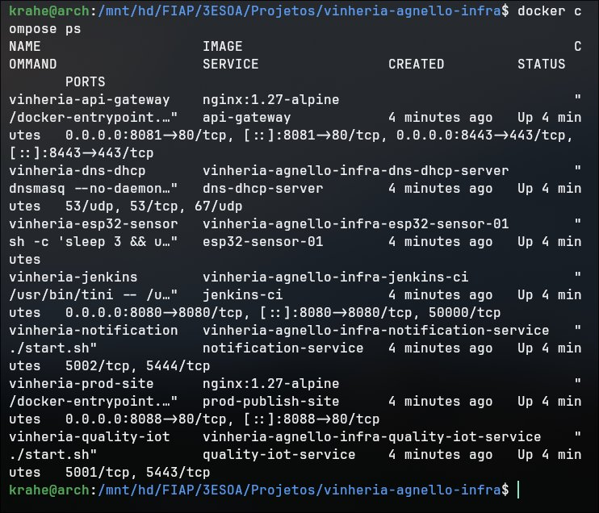
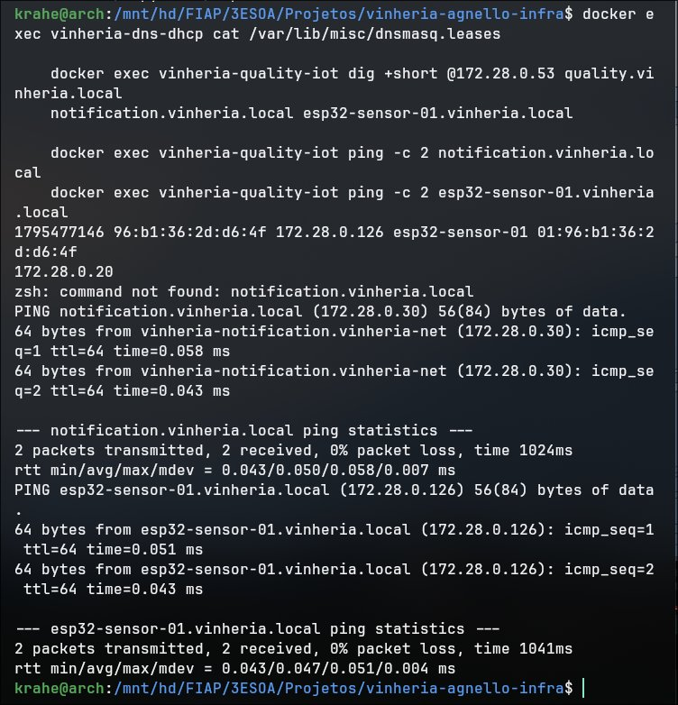
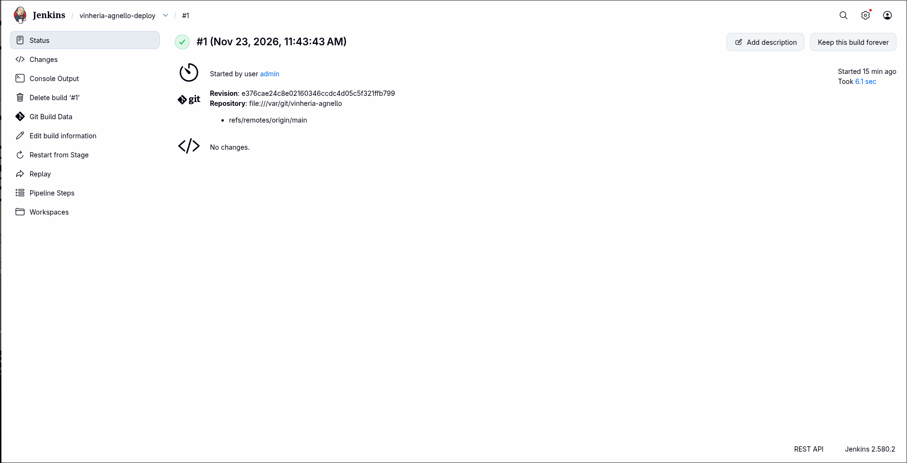
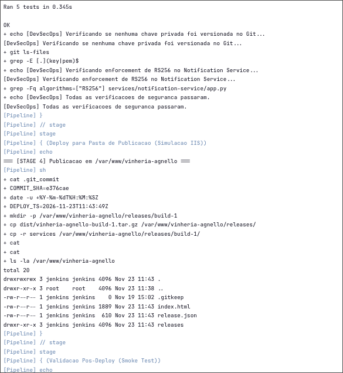
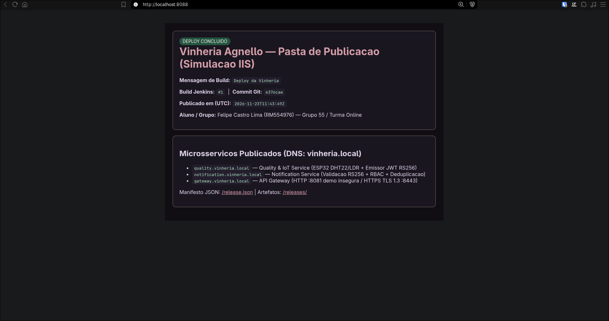
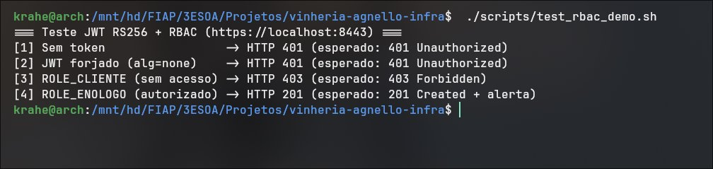
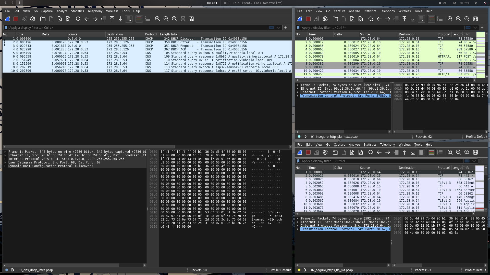
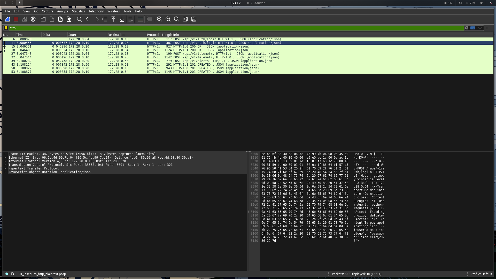

# Relatório Técnico — Infraestrutura, Pipeline DevOps (Jenkins) e DevSecOps da Vinheria Agnello

| Campo | Valor |
| :--- | :--- |
| **Aluno** | Felipe Castro Lima |
| **RM** | rm554976 |
| **Turma / Grupo** | Turma Online — Grupo 55 |
| **Base Arquitetural** | `FelipeCastroLima_rm554976_TurmaOnline_fase6_atividade.docx` + `Entrega_FIAP_Vinheria_Agnello_Grupo55.zip` |
| **Repositório Local** | `/mnt/hd/FIAP/3ESOA/Projetos/vinheria-agnello-infra` (branch `main`) |

---

## 1. Infraestrutura e Serviços Essenciais

### 1.1. Microsserviços Selecionados da Fase 6

A partir dos seis microsserviços modelados na Fase 6, foram implementados os dois domínios diretamente integrados à camada IoT do Grupo 55 (ESP32 DevKit V1 + DHT22 no GPIO 4 + LDR no GPIO 34 ADC1):

1. **Quality & IoT Service (`quality.vinheria.local` — `172.28.0.20`)**: recebe telemetria JSON (`temperatura`, `umidade`, `luminosidade`), aplica as regras bioquímicas da adega (cinética de Arrhenius > 16 °C / crítico > 18 °C, desidratação de rolha < 60% / crítico < 55%, risco fitoquímico *Goût de Lumière* > 15% / crítico > 30%), persiste leituras em banco SQLite próprio (*Database per Service*), emite tokens JWT assinados com **RS256** (`/.well-known/jwks.json`) e despacha o evento `AlertaQualidadeTermicaDisparado` para o `Notification Service`.
2. **Notification Service (`notification.vinheria.local` — `172.28.0.30`)**: expõe `/api/v1/alerts`, valida assinatura assimétrica **RS256** do JWT e políticas **RBAC**, deduplica eventos por `eventId` e persiste o histórico em banco SQLite isolado (*Database per Service*).

### 1.2. Topologia de Rede Docker, DNS Autoritativo e DHCP Dinâmico

Toda a infraestrutura opera na rede bridge isolada `vinheria-net` (`172.28.0.0/24`, interface host dedicada **`br-vinheria`** para captura limpa no Wireshark):

```text
                      HOST (Wireshark na interface br-vinheria)
                                         │
        ┌────────────────┬───────────────┼───────────────┬────────────────┐
        │ :8081 (HTTP)   │ :8443 (HTTPS) │ :8080 (HTTP)  │ :8088 (HTTP)   │
        ▼                ▼               ▼               ▼                │
┌─────────────────────────────────────────────────────────────────────────┴───┐
│                   Rede Docker vinheria-net (172.28.0.0/24)                  │
│                                                                             │
│  dns-dhcp-server (172.28.0.53) ◄── DHCP DORA (.100-.150) ── esp32-sensor-01 │
│   • DNS autoritativo vinheria.local                         (172.28.0.126)  │
│   • Registro DNS dinâmico via leases DHCP                         │         │
│         ▲                                                         │ REST    │
│         │ UDP/53                                                  ▼         │
│  api-gateway (172.28.0.10 - Nginx)                                          │
│   • :80  HTTP  (Demo Insegura)   ──► quality.vinheria.local (172.28.0.20)   │
│   • :443 HTTPS (TLS 1.3 Seguro)  ──►   └──► notification.vinheria.local     │
│                                             (172.28.0.30) [HTTP :5002 /     │
│                                                            HTTPS :5444]     │
│  jenkins-ci (172.28.0.40) ──► volume /var/www/vinheria-agnello              │
│                                  ──► prod-publish-site (172.28.0.50, IIS)   │
└─────────────────────────────────────────────────────────────────────────────┘
```

### 1.3. Evidências de Containers, DHCP (DORA) e DNS Dinâmico



- **Lease DHCP gravado em `/var/lib/misc/dnsmasq.leases`:**
  ```text
  1795477146 96:b1:36:2d:d6:4f 172.28.0.126 esp32-sensor-01 01:96:b1:36:2d:d6:4f
  ```
- **Pacotes capturados no Wireshark (`captures/03_dns_dhcp_infra.pcap`, Transaction ID `0x4000b156`):**
  ```text
  1  0.000000  0.0.0.0     -> 255.255.255.255  DHCP Discover (Transaction ID 0x4000b156)
  2  0.000196  172.28.0.53 -> 172.28.0.126     DHCP Offer
  3  0.022013  0.0.0.0     -> 255.255.255.255  DHCP Request
  4  0.023298  172.28.0.53 -> 172.28.0.126     DHCP ACK (IP 172.28.0.126, DNS 172.28.0.53, dom vinheria.local)
  5  0.093495  172.28.0.64 -> 172.28.0.53      DNS Query A quality.vinheria.local
  6  0.093558  172.28.0.53 -> 172.28.0.64      DNS Response A 172.28.0.20
  7  0.151249  172.28.0.64 -> 172.28.0.53      DNS Query A notification.vinheria.local
  8  0.151309  172.28.0.53 -> 172.28.0.64      DNS Response A 172.28.0.30
  9  0.207519  172.28.0.64 -> 172.28.0.53      DNS Query A esp32-sensor-01.vinheria.local
  10 0.207596  172.28.0.53 -> 172.28.0.64      DNS Response A 172.28.0.126
  ```



---

## 2. Pipeline de Deploy com Jenkins

### 2.1. Repositório Git e Provisionamento Automatizado

- Repositório Git inicializado na branch `main` contendo os microsserviços (`services/`), suíte de testes unitários (`tests/test_services.py`), `Jenkinsfile` declarativo e infraestrutura como código (`docker-compose.yml`).
- Container `vinheria-jenkins` (`jenkins/jenkins:lts-jdk21`) provisionado automaticamente via `init.groovy.d/` com usuário `admin`, plugins `workflow-aggregator` e `git`, e job `vinheria-agnello-deploy`.

### 2.2. Estágios do `Jenkinsfile` e Evidências da Execução (Build #1 — `SUCCESS`)

| Estágio | Ações Executadas | Evidência Verificada |
| :--- | :--- | :--- |
| **1. Checkout** | Clone Git da branch `main` (`file:///var/git/vinheria-agnello`) | Revisão `e376cae` (`6.1 sec` total) |
| **2. Build** | Executa `echo "Deploy da Vinheria"`, `python3 -m py_compile` nos microsserviços e empacota tarball versionado | `dist/vinheria-agnello-build-1.tar.gz` |
| **3. Testes & DevSecOps** | Executa `unittest` (regras enológicas + JWT RS256 + RBAC + deduplicação), verifica ausência de `.key`/`.pem` no Git e enforcement de `RS256` | `Ran 5 tests in 0.345s — OK` |
| **4. Deploy (Simulação IIS)** | Publica `index.html`, `release.json`, pacote `.tar.gz` e código dos serviços em `/var/www/vinheria-agnello` (`./deploy/wwwroot`) | Publicado em `2026-11-23T11:43:49Z` e servido em `http://localhost:8088` |
| **5. Smoke Test Pós-Deploy** | Resolve `prod-site.vinheria.local` e `gateway.vinheria.local` via DNS `172.28.0.53` e valida HTTP 200 e HTTPS TLS 1.3 `/health` | `status: PUBLISHED` e `tls: true` |







---

## 3. Comunicação Segura e DevSecOps

### 3.1. Modelo de Comunicação, Autenticação JWT RS256 e RBAC

- **Protocolo:** REST/JSON síncrono protegido por **HTTPS (TLS 1.3)** tanto no tráfego norte-sul (`esp32-sensor-01 -> api-gateway -> quality-iot-service`) quanto no tráfego leste-oeste entre microsserviços (`quality-iot-service -> notification-service`, com validação de certificado da CA interna e SNI `notification.vinheria.local`).
- **Autenticação e Autorização:** Tokens **JWT assinados com RS256** (chave assimétrica RSA-2048) e chave pública exposta em `/.well-known/jwks.json`. Na chamada leste-oeste, o `quality-iot-service` emite um token de serviço de curta duração (`ROLE_SERVICE_QUALITY`, 5 min).

| Teste de Segurança Executado | Resultado Esperado | Resultado Observado |
| :--- | :--- | :--- |
| `POST /api/v1/telemetry` sem header `Authorization` | `401 Unauthorized` | **HTTP 401** |
| `POST /api/v1/telemetry` com JWT adulterado (`alg: none`) | `401 Unauthorized` | **HTTP 401** |
| `POST /api/v1/telemetry` autenticado como `ROLE_CLIENTE` | `403 Forbidden` | **HTTP 403** |
| `POST /api/v1/telemetry` autenticado como `ROLE_ENOLOGO` (leitura crítica `19.8 °C`, `52.4%`, `18.5%`) | `201 Created` + alerta em `notification-service` | **HTTP 201** (`ALERT_DISPATCHED`) |



### 3.2. Demonstração Forense no Wireshark: HTTP Texto Claro vs. HTTPS (TLS 1.3)

| Critério Analisado | Cenário Inseguro (`01_inseguro_http_plaintext.pcap`) | Cenário Seguro (`02_seguro_https_tls_jwt.pcap`) |
| :--- | :--- | :--- |
| **Portas / Protocolo** | HTTP texto claro (`:80`, `:5001`, `:5002`) | HTTPS **TLS 1.3** (`:443`, `:5443`, `:5444`) |
| **Credenciais de Login** | **EXPOSTAS em texto puro** (Frame 11): `{"username": "enologo", "password": "Agnello@2026"}` | **Cifradas** (`Application Data`) — 0 ocorrências |
| **Token JWT (`Bearer`)** | **EXPOSTO em texto puro** no tráfego externo e interno (`172.28.0.20 -> 172.28.0.30`), permitindo sequestro de sessão (*replay attack*) | **Cifrado** ponta a ponta — 0 ocorrências |
| **Payload de Telemetria/Alerta** | **EXPOSTO em texto puro** (`ADEGA-BARRIQUE-03`, `temperatura: 19.8`, `AlertaQualidadeTermicaDisparado`) | **Cifrado** ponta a ponta — 0 ocorrências |





**Conclusão DevSecOps:** a assinatura digital do JWT (RS256) garante **integridade e autenticidade** (impede forjar papéis ou alterar claims), mas **não fornece confidencialidade** (o payload é apenas Base64URL). Sem criptografia de transporte (TLS 1.3), qualquer agente passivo na rede intercepta as credenciais de login e o próprio Bearer Token válido para reutilizá-los contra a API. A combinação **TLS 1.3 + JWT RS256 + RBAC** mitiga interceptação, adulteração e escalação de privilégios simultaneamente.
